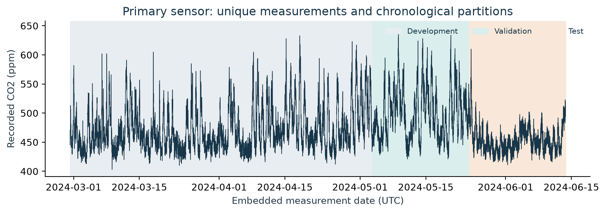
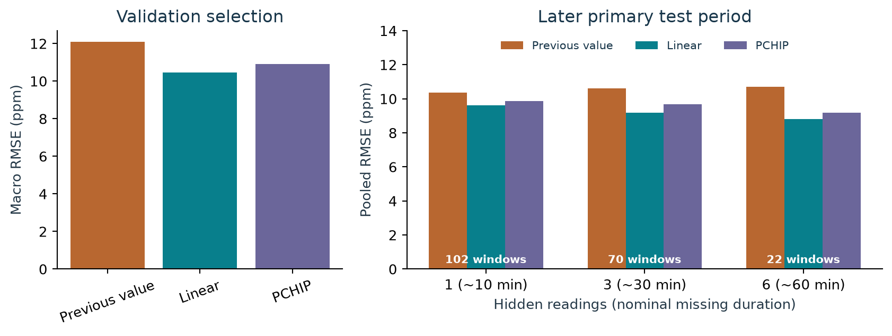
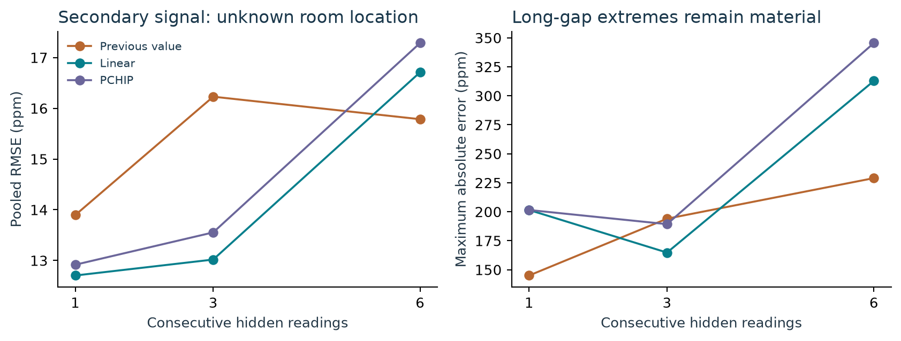
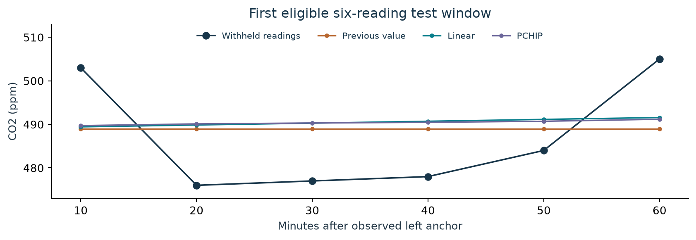
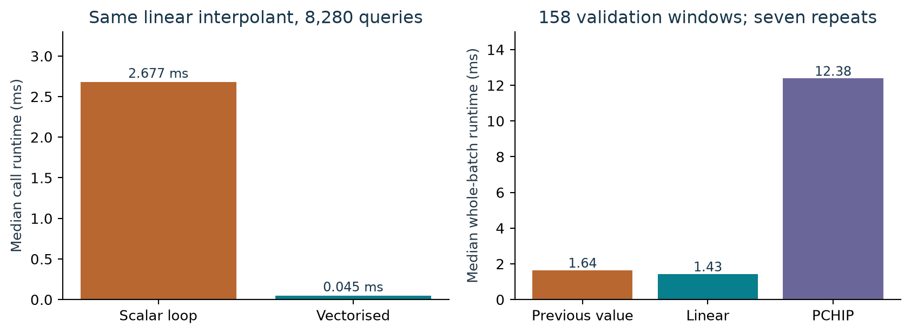

# Retrospective CO2 gap reconstruction

MMA3001 Numerical Methods and Machine Learning | Preset Dataset 2 | Lachlan Elliott 

## 1. Engineering question and input/output contract

Building environmental monitoring depends on usable time histories. Exported records can contain old measurements, repeated transmissions and gaps; treating every row as a fresh observation would misrepresent coverage. This project asks: **Which local numerical method best reconstructs short, bounded CO2 gaps in the supplied environmental data, and how do accuracy, transferability and computational cost compare?** Missing-measurement reconstruction is an offered direction within preset Dataset 2 [1].

The intended use is retrospective review after communication resumes. Both sides of a gap are available. No real-time forecasting, occupancy prediction, ventilation-rate estimation or health classification is attempted. CO2 remains a recorded concentration in parts per million (ppm), rather than a direct measurement of any of those outcomes.

| Primary input | Format and unit | Meaning and handling |
|---|---|---|
| Environmental export | ZIP containing CSV and JSON | Embedded Unix seconds identify measurements; processing dates are audited separately. |
| Location metadata | Two-sheet XLSX workbook | Room associations require a unique, credible ID match. |
| Reconstruction input | Ordered time/value arrays; seconds and ppm | Finite, distinct times and finite concentrations; queries must be bounded by observed times. |
| Outputs | CSV, JSON, figures and arrays | Reconstructed ppm, residual metrics, gap coverage, frozen selection and measured performance. |

The primary series has 13,800 distinct measurement times from sensor 6012002000869, uniquely associated with Building 60, room G.38, Compactus_upper, label EMS107. Its measured CO2 range is 403-646 ppm. Observations outside this range are not automatically impossible elsewhere; the range describes this series only.

Linear interpolation is selected using earlier validation observations and then evaluated without retuning. Final primary RMSE is 9.61, 9.17 and 8.81 ppm for one, three and six hidden readings respectively. A separate sensor exposes a failure for six-reading gaps. These are errors against withheld instrument readings, with no externally justified pass/fail threshold. The conclusion is therefore a bounded comparison of methods, supported by an explicit audit and reproducible numerical evidence.

<!-- PAGE BREAK -->

## 2. Source audit and defensible observations

The complete environmental CSV contains **179,447 records**, five sensor IDs and no repeated database row IDs. Its JSON holds named variables with units and measurement timestamps. CO2, temperature and humidity are present and finite in every record. Other variables are less complete: formaldehyde includes 113,380 null values. Preparation verifies units and values rather than assuming every exported variable is usable.

Deduplication by sensor and embedded measurement time leaves **42,843 observations**, removing **136,604 repeated records**. Repeated CO2, temperature and humidity agree exactly. Conflicting duplicates would raise an error instead of being averaged silently. Each prepared observation retains its ingestion count, UTC time and mapping status. Source sizes, SHA-256 hashes, workbook contents and cleaning counts are preserved.

| Sensor ID suffix | Export rows | Unique times | Interpretation |
|---|---:|---:|---|
| 00241 | 58,908 | 2 | Frozen; unsuitable temporal evidence |
| 00326 | 58,909 | 29,039 | Unmapped; separate later-series check |
| 00777 | 10,926 | 1 | Frozen; unsuitable temporal evidence |
| 00869 | 29,341 | 13,800 | Uniquely mapped primary series |
| 00227 | 21,363 | 1 | Frozen; unsuitable temporal evidence |

The export names' May-December 2024 description does not match their actual measurement coverage. In **136,052 records**, database creation time differs from measurement time by more than an hour. Using creation time would turn repeated stale payloads into an artificial signal. Three frozen series are excluded through timestamp quality, not reconstruction outcomes.

The complete occupancy archive contains **9,091,732 records**, one device UUID and five floor-space UUIDs. Its mapping worksheet explicitly states “Incorrect Data”; three observed spaces are absent, and no verified pairing connects occupancy with primary room G.38. Occupancy is audited but excluded from numerical inputs and targets. The ENV sheet also duplicates another ID across two rooms; that ambiguity is not resolved by guessing. Files labelled **Example Data (Do not use)** are inventoried and excluded. Five independently sampled prepared observations match raw JSON values and ingestion counts.

<!-- PAGE BREAK -->

## 3. Local numerical methods and assumptions

For retained observations `(t_i, c_i)`, time is measured in seconds and concentration in ppm. A local origin is subtracted before interpolation; this changes neither elapsed intervals nor predictions. Four observed points on each side supply identical context to every method, while the hidden values remain separate scoring targets.

The previous-observation baseline holds the most recent retained value. It is cheap and interpretable, but cannot anticipate a change inside the gap. Linear interpolation blends the two bounding observations [3, 5]:

`c_hat(t) = c_L + (c_R - c_L)*(t - t_L)/(t_R - t_L)`

Its weights sum to one inside the interval, so its prediction stays between those endpoints. This property cannot recover an unobserved peak or prove physical correctness. A readable scalar implementation independently performs segment searches and the same blend; NumPy supplies the production evaluation.

PCHIP uses local piecewise cubic Hermite polynomials with slopes constrained by neighbouring observations. SciPy documents continuous first derivatives and monotonicity preservation [6]. Shape preservation is a useful property, not a promise of lower error on noisy CO2 measurements. Higher polynomial degree is therefore tested as an alternative rather than presumed superior.

All methods reject nonfinite or mismatched arrays, duplicated or unordered known timestamps, and out-of-domain queries. Query order is preserved; there is no extrapolation. Actual timestamps retain sampling jitter and missing intervals; no artificial regular grid is presented as new measured information. The core question is interpolation, directly connected to supplied notebook 3.1. Supplied notebook 6.3 informs a separate integration judgement discussed in Section 7.

<!-- PAGE BREAK -->

## 4. Frozen validation and verification design

The primary observations are split chronologically by count: first **60% development**, next **20% validation**, final **20% test**. Development supports inspection, implementation checks and performance experiments. These interpolants have no learned training parameters; the first partition is not described as fitting a predictive model. No context crosses partition boundaries.

| Partition | Observations | UTC measurement period |
|---|---:|---|
| Development | 8,280 | 29 February-3 May 2024 |
| Validation | 2,760 | 3-24 May 2024 |
| Final test | 2,760 | 24 May-13 June 2024 |

Candidate gaps start after four context observations, then every 12 observations. Hide **one, three or six consecutive readings**, retaining four points on each side. Every original timestamp step throughout that context-and-target window must be at most **900 seconds**. All methods receive identical visible knots and target times; withheld concentrations never enter their inputs. This eligibility rule restricts evaluation to otherwise well-observed stretches.

At nominal ten-minute cadence, one, three and six missing readings conventionally represent 10, 30 and 60 missing nominal minutes. Six hidden readings span about 50 minutes from first to last; their observed endpoints bracket about 70 minutes. These are different quantities. Counts identify the experiments; exact elapsed bracket and hidden-sample spans are saved per window.

For residual `e = reconstructed - recorded`, report MAE, RMSE, maximum absolute error and signed bias, all in ppm. Within a gap size, metrics pool all hidden readings. Selection minimises the mean of the three validation RMSE values. Methods within 1% of the minimum are tied, resolved by declared simplicity order: previous, linear, PCHIP. The policy and prepared-data hash are saved before final or secondary evaluation.

**All 98 tests passed** in the fresh pinned environment, with a recorded suite time of 17.98 seconds. Checks cover manufactured constant/linear signals, knot reproduction, manual metric calculations, scalar/library agreement, masking separation, invalid inputs, ingestion-time traps and conflicting duplicates. These verify implementation behaviour; they do not calibrate the instruments. Windows across gap sizes can overlap, so no naive independence claim or confidence interval is attached.

<!-- PAGE BREAK -->

## 5. Selection and final primary evidence

Validation macro-RMSE is **12.0809 ppm** for previous-value hold, **10.4676 ppm** for linear interpolation and **10.8996 ppm** for PCHIP. Linear is uniquely preferred under the predeclared 1% tie rule. Its selection is saved in `selection_frozen.json` before scoring the later primary block. Final results support that choice on this series without changing the protocol.

| Hidden readings | Test windows | Previous RMSE | Linear RMSE | PCHIP RMSE |
|---|---:|---:|---:|---:|
| 1 | 102 | 10.3569 | 9.6117 | 9.8575 |
| 3 | 70 | 10.6162 | 9.1730 | 9.6860 |
| 6 | 22 | 10.6952 | 8.8062 | 9.1794 |

Linear has the lowest pooled test RMSE in all three comparisons. Its test MAE is 7.8436, 7.3977 and 7.0852 ppm; bias is -0.5688, -1.1668 and +0.2499 ppm. Small mean bias can coexist with sizeable individual errors: its maximum absolute errors are **29.0117, 23.5000 and 35.7146 ppm**. Previous hold has smaller maxima for counts one and six, 26 and 28 ppm. Linear does not dominate every criterion.

Coverage is a material limitation. Validation accepts only **95/230**, **57/230** and **6/229** candidate windows; test accepts **102/230**, **70/230** and **22/229**. Longer windows are less likely to satisfy the cadence condition. Consequently, the lower six-reading RMSE does **not** show that longer outages improve reconstruction. Different retained populations, and just six long-gap validation windows, limit the strength of that inference. Complete exclusions and per-window metrics remain available for review.

<!-- PAGE BREAK -->

## 6. Secondary sensor and an observed failure

The frozen policy is also evaluated on environmental sensor **6012002000326**, whose location is unresolved in the supplied workbook. A declared calendar filter keeps its **29,038 observations after 1 January 2025 UTC**; the retained series actually begins in September 2025 and ends in April 2026. Its isolated 2023 reading is excluded through this date rule, not through examination of reconstruction errors. The same context, cadence and masking settings apply.

| Hidden readings | Windows | Previous RMSE | Linear RMSE | PCHIP RMSE |
|---|---:|---:|---:|---:|
| 1 | 1,134 | 13.8953 | 12.7036 | 12.9160 |
| 3 | 826 | 16.2287 | 13.0179 | 13.5531 |
| 6 | 392 | 15.7849 | 16.7105 | 17.2868 |

For six-reading gaps, linear's RMSE is **16.7105 ppm**, worse than the baseline's **15.7849 ppm**, although its MAE remains smaller, 8.6071 versus 9.6607 ppm. Its maximum error is a **312.8571 ppm overprediction**, approximately 753.857 versus 441 ppm. Mean bias is only +0.3443 ppm, so this is not a large systematic offset. Large residuals carry greater weight in RMSE than MAE. PCHIP's smoothness does not remove this tail failure.

This is useful evidence against universal deployment of the primary choice. It shows transportability is limited across the available signals. It does not establish a known second-room effect, identify the physical cause, or prove that a particular event was missed. No occupancy or ventilation explanation is inferred from an unmapped sensor. The selected method is **not retuned** after observing this failure. A future adaptive policy would require a newly declared development study and fresh final evidence.

<!-- PAGE BREAK -->

## 7. Inspecting a gap and interpreting error

The demonstration uses the **first eligible six-reading gap in the final partition**, rather than selecting an attractive reconstruction. Its recorded hidden values are **503, 476, 477, 478, 484 and 505 ppm**. The previous-value baseline holds 489 ppm, while linear interpolates approximately 489.43-491.57 ppm between its visible endpoints. Both miss variation inside the interval. PCHIP changes the curve without observing those hidden fluctuations.

This example explains why a low pooled RMSE must be accompanied by tail errors and inspectable cases. It illustrates the interpolation assumption: observed endpoint behaviour is informative about the interior. An abrupt event can violate that assumption even when timestamps are regular. The exported reconstruction table preserves query times, recorded targets and each method's predictions for inspection.

Three error sources remain distinct. Implementation error is addressed by manufactured examples and tests. Interpolation discrepancy is measured against withheld readings. Sensor error and calibration uncertainty are unknown because no independently calibrated reference is supplied. Exact agreement at an observed knot only verifies interpolation through that recorded value. Artificial gaps also cannot reproduce every real outage mechanism, particularly outages associated with unusual operating conditions.

The supplied Romberg notebook is relevant to judgement rather than a compulsory extra algorithm [4]. Sample-based Romberg requires equally spaced `2^k + 1` samples [7]; these observations are irregular and potentially noisy. Resampling would not create extra physical information. A separately tested trapezoidal helper exactly integrates a chosen piecewise-linear representation in ppm-seconds, but no resulting number is claimed as exposure, ventilation performance or an exact physical integral. Integration is therefore kept outside the project's main empirical conclusions.

<!-- PAGE BREAK -->

## 8. Performance, storage and reproducibility

Accuracy selection precedes optimisation. A genuine scalar linear interpolator uses binary segment searches and evaluates the same formula as the production implementation. On identical development inputs, **1,657 known points** and **8,280 queries**, including queries at known knots, maximum scalar/vectorised disagreement is **1.1369e-13 ppm**, consistent with small floating-point evaluation differences. The comparison changes implementation overhead rather than the scientific method.

After warm-up, seven complete calls give median times **2.6775 ms scalar** and **0.045292 ms vectorised**, a **59.116-fold** speedup. Recorded ranges are 2.6011-2.7070 ms and 0.044125-0.045875 ms. Profiling is retained in `results/profile.txt`. Separately, evaluating 158 validation windows takes median 1.6394 ms for previous, 1.4295 ms for linear and 12.3820 ms for PCHIP, including per-window construction and evaluation.

Storage for the retained benchmark arrays totals **225,232 bytes**, scaling as `O(K + Q)` for known and query counts. This is array storage, not measured peak process RAM. The scalar search workload scales as `O(K + Q log K)` including validation; library implementation details and query ordering affect realised performance. No workstation timing is presented as a universal complexity guarantee.

Each scalar linear blend uses about six basic arithmetic operations: approximately 49,680 for 8,280 queries. This excludes searches, validation, allocation and Python control flow. Matching blend arithmetic therefore does not imply matching runtime.

The measured environment is Python 3.12.14, NumPy 2.3.5, SciPy 1.18.1 and pandas 2.2.3 on macOS ARM64. Exact dependencies, prepared-data hashes, configuration, source preparation, tests and figure/report commands are supplied. Occupancy ingestion uses 250,000-row chunks; individual occupancy records are not materialised together or exported. Numerical outputs should reproduce under the fixed inputs; timing can vary. Verification records must distinguish a fresh dependency environment from any separately completed clean-clone check.

<!-- PAGE BREAK -->

## 9. Conclusions, lessons

For this audited primary series and frozen artificial-gap protocol, **piecewise linear interpolation is the preferred retrospective method**. It has the lowest validation selection score and lowest final primary RMSE at all three tested missing counts, while vectorised evaluation is inexpensive. PCHIP's additional smoothness does not improve these comparisons enough to justify its larger measured construction cost. Previous-value hold remains a credible baseline and outperforms linear on secondary six-reading RMSE.

The largest practical lesson is that trustworthy observation identity precedes interpolation. More than three quarters of environmental export records repeat existing measurement times; treating ingestion time as new evidence would overwhelm the numerical comparison with a data error. Resolving units, duplicates and room mappings produces a smaller but defensible study. The timestamp-based exclusions are reported because benchmark coverage is part of the result.

Further limitations are substantial. One mapped room supports the main conclusion, the primary CO2 range is narrow, long-gap validation has only six accepted windows, and cross-size populations differ. Calibration and physical truth remain unknown. Real outages lack withheld targets, and observations after a gap are required. Broader deployment would need verified locations, more sensors, representative outages, independent references and a prospectively defined acceptance criterion. None is manufactured here to turn comparative ppm errors into an engineering safety claim.

<!-- PAGE BREAK -->
## 10. AI declaration
**AI disclosure:** 
There were two tools I used to construct this project one being Chatgpt (GPT-6.1 Sol) accessed through the desktop app and google gemini through the google search bar which was mainly used to for general questions and clarification. Codex produced a large amount of the content, including the audit implementation, numerical code, tests. It was also used to suggest improvements I could make, checking the content against the rubric and how I could around using github as a beginneer.

My coding knowledge is nowhere near the required amount for numerical interpolation and validation. I only modified small parts of the code myself as chatgpt was able to do the bulk of it allowing me to save time and focus on reviewing the code and suggesting improvements or refinements rather then wasting time writing it myself. It also gave a clear breakdown of a general guide of what should be included in the technical report and presentation slides. 

In saying this I did not treat anything Chatgpt did as a fully correct output. I confirmed that the full test suite passed in a fresh, pinned environment, checked the scalar and vectorised linear interpolants agreed to within floating-point precision, and reproduced the validation selection that chose linear interpolation over the previous-value and PCHIP alternatives under the predeclared 1% tie rule. I also checked the reported RMSE, MAE and maximum-error figures for the primary and secondary sensors against the underlying data, and confirmed the eligibility and coverage counts for each gap size. I referred back to the project brief throughout to make sure the project stayed within its requirements.

AI did also make some unhelpful suggestions that I thought was best to change. One of these is the selection of mathematical techniques to predict the hidden co2 readings. Chatgpt orginally suggested using a global polynomial interpolation, however reading through the 3.1 notes I found that these tend to have problems with oscillation which can introduce peaks or dips between readings. Following this finding and further clarification with chatgpt, it was then decided that a PCHIP (piecewise cubic hermite interpolation polynomial) should be used as it joins cubic segments between readings while preserving local trends and limiting overshoot. 

Working through this project has taught me how to choose and test a numerical method using real data, contruct a github repository, better work with AI to produce an superior output, commit changes and many more things that im sure will come in handy on my journey as an engineer

<!-- PAGE BREAK -->

## References

[1] Monash University, MMA3001. *Week 5: Keenan Granland*, supplied PDF, Dataset 2 description, p. 37. Preset Monash Smart Infrastructure Occupancy and Environmental Data; supplied Dataset 2 and original sensor exports.

[2] Monash University, MMA3001. *2026 Project Brief*, supplied 15-page PDF, including the complete assessment rubric. *Workshop 11* and *Workshop 12* slides, supplied PDFs. Used for scope, deliverables, responsible AI disclosure and interview requirements.

[3] Monash University, MMA3001. *Notes Week 03.1: Interpolation and Extrapolation*, supplied notebook, all 27 cells reviewed. Local interpolation, domain handling and sensitivity.

[4] Monash University, MMA3001. *Notes Week 06.3: Romberg and Richardson Extrapolation*, supplied notebook, all 48 cells reviewed. Smoothness, equal spacing, sample-count conditions and limits of numerical error estimates.

[5] NumPy Developers. [numpy.interp documentation](https://numpy.org/doc/stable/reference/generated/numpy.interp.html). Piecewise linear interpolation and increasing-coordinate requirements. Accessed 25 October 2026; installed study version recorded separately.

[6] SciPy Developers. [PchipInterpolator documentation](https://docs.scipy.org/doc/scipy/reference/generated/scipy.interpolate.PchipInterpolator.html). Shape-preserving piecewise cubic Hermite interpolation, domain and slope properties. Accessed 25 October 2026.

[7] SciPy Developers. [scipy.integrate.romb documentation](https://docs.scipy.org/doc/scipy/reference/generated/scipy.integrate.romb.html). Sample-based Romberg integration and equally spaced sample requirements. Accessed 25 October 2026.
